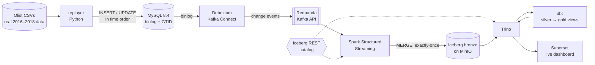

# raw-lakehouse

A **real-time CDC lakehouse** that runs on a laptop with Docker. A real e-commerce database changes every second, every change is captured within seconds, stored in an open lakehouse, modelled with dbt and shown on a live dashboard.

Built step by step while learning data engineering.

## Architecture



| Layer | Tool | What it does here |
|---|---|---|
| Source | **MySQL 8.4** | The shop's database. Binlog in ROW mode with full row images and GTIDs |
| Simulation | **replayer** (Python) | Turns the Olist snapshot back into ~593k time-ordered events and applies them at 20/s |
| Capture | **Debezium 3.0** on Kafka Connect | Reads every insert/update/delete from the binlog |
| Transport | **Redpanda** | Kafka-compatible log; one topic per table |
| Processing | **Spark Structured Streaming** | Micro-batches every 15 s into the bronze table |
| Storage | **Apache Iceberg** on **MinIO** | Open table format on S3-compatible storage, via a REST catalog |
| Query | **Trino** | SQL over Iceberg (and over MySQL, for comparisons) |
| Transform | **dbt** | Bronze → silver (current state) → gold (business metrics), with tests |
| Serve | **Superset** | Dashboard, auto-refreshing every 30 s |

## The data

The [Olist Brazilian E-Commerce dataset](https://www.kaggle.com/datasets/olistbr/brazilian-ecommerce): ~100k real orders (2016–2018) with customers, sellers, products, payments and reviews. Licence **CC BY-NC-SA 4.0**; it is **not stored in this repo**.

Download it from Kaggle and unzip the CSV files into `data/olist/` (for example `data/olist/olist_orders_dataset.csv`).

Profiling found real problems, which the pipeline handles on purpose:

| Issue in the source | Where it is handled |
|---|---|
| 1,382 orders with timestamps going backwards (e.g. shipped before approved) | replayer clamps event time, never goes back in time |
| Column names misspelled (`product_name_lenght`) | renamed on load (`mysql/init/01_catalog_tables.sql`) |
| Category CSV has Windows line endings and a BOM | `LINES TERMINATED BY '\r\n'` |
| 13 products whose category has no English name | `silver_products` falls back to the Portuguese name |
| 547 orders with more than one review | `gold_order_facts` keeps the newest |
| 775 orders without items; payment ≠ items + freight for some | dbt warning tests (`tests/`) |
| Reviews written up to 106 days after delivery | real late-arriving data, see below |

## Run it

Requirements: Docker Desktop (WSL 2 on Windows) and the dataset in `data/olist/`.

**Ingest mode: the real-time pipeline**
```bash
docker compose up -d --build
```
| Check | How |
|---|---|
| Shop is changing | `docker compose logs -f replayer` |
| Change events in Redpanda | Redpanda Console → http://localhost:8085 |
| Connector is running | `curl http://localhost:8083/connectors/shop-mysql/status` |
| Spark is writing | `docker compose logs -f spark` (`batch N: … change events`) |
| Files in the lake | MinIO console → http://localhost:9001 (minioadmin / minioadmin) |

**Analyze mode: query, transform, dashboard**
```bash
docker compose stop spark console              # optional: frees RAM on small machines
docker compose --profile analytics up -d trino superset
docker compose --profile analytics run --rm dbt build
```
| Service | URL |
|---|---|
| Superset dashboard | http://localhost:8088/superset/dashboard/olist-live/ (admin / admin) |
| Trino | `docker exec -it trino trino` |

On a machine with 8 GB+ for Docker, run both modes at once and the dashboard is live end to end. With less, pause Spark while analysing; when it restarts it catches up from its checkpoint, exactly once.

**Run the replay locally instead of in Docker** (handy for development)
```bash
python -m venv .venv && .venv\Scripts\activate      # Linux/macOS: source .venv/bin/activate
pip install -r replayer/requirements.txt
python replayer/replay.py                             # uses 127.0.0.1:3307 by default
```

## How it handles the hard parts

### Exactly-once processing
Every hop is designed so a crash never loses or duplicates a change:

1. **Replayer → MySQL**: the event and its bookmark (`replay_state.next_event`) are written in **one transaction**. A crash before commit undoes both; after commit, both are saved.
2. **MySQL → Redpanda**: Debezium stores its binlog position (GTID) in Kafka Connect offsets and resumes from it.
3. **Redpanda → Iceberg**: Spark's **checkpoint** records the processed Kafka offsets, and each batch is written with a **MERGE on (topic, partition, offset)**, so a retried batch inserts nothing twice.

Proof: the dbt test `no_duplicate_cdc_events` checks that every Kafka message is in bronze exactly once. It passes after Spark restarts. To try it yourself, run `docker compose restart spark` mid-stream and rerun `dbt build`.

### Schema changes
Bronze stores each row's `before`/`after` as JSON, so a new MySQL column can't break ingestion. Try it while everything runs:
```powershell
Get-Content scripts\schema_change_demo.sql | docker exec -i mysql mysql -uroot -prootpass shop
```
Debezium adds the field to new events, Spark keeps going, and `silver_orders.sales_channel` fills in. Rows changed before the ALTER show NULL.

### Late-arriving data
Reviews arrive days or months after delivery, and every change carries two clocks:
- **event time**: when it happened in the shop (`purchased_at`, `created_at`, …)
- **processing time**: when the pipeline saw it (`changed_at`, `ingested_at`)

Gold models aggregate by **event time**, so a late review lands on the right order and month instead of inflating today. Silver and gold are **views** over bronze, so late data is included on the next query, with no backfill job. `gold_late_arrivals` measures how late reviews are, and dbt **source freshness** warns if ingestion stops (`dbt source freshness`).

## Data quality and tests

| What | Where | Runs |
|---|---|---|
| Unit tests for the replay logic (event order, cancellations, time going backwards, reviews) | `replayer/tests/` | CI + `pytest` |
| Lint | `ruff.toml` | CI + `ruff check` |
| Keys unique / not null, valid statuses and scores, relationships, non-negative money, table grains | `dbt/models/**/*.yml` | `dbt build` |
| Exactly-once (no duplicate Kafka offsets in bronze) | `dbt/tests/no_duplicate_cdc_events.sql` | `dbt build` |
| Business rules as warnings (payments vs. order value, orders without items) | `dbt/tests/` | `dbt build` |
| Pipeline freshness | `dbt/models/sources.yml` | `dbt source freshness` |

GitHub Actions (`.github/workflows/ci.yml`) runs lint and unit tests, checks that the dbt project compiles, validates the compose file and connector config, and builds the replayer image.

## Project structure

```
raw-lakehouse/
├── docker-compose.yml          # all services; "analytics" profile for Trino, dbt, Superset
├── mysql/init/                 # schema, catalog load, replay bookmark, Debezium user
├── replayer/                   # Olist → time-ordered events → MySQL (+ tests, Dockerfile)
├── connect/shop-mysql.json     # Debezium connector config
├── spark/stream_cdc.py         # Redpanda → Iceberg bronze, exactly-once
├── trino/                      # Iceberg + MySQL catalogs, JVM sizing
├── dbt/                        # silver and gold models, macros, tests
├── superset/                   # image + dashboard created through the API
├── scripts/                    # schema-change demo
└── .github/workflows/ci.yml
```

## Notes and limits

- Credentials are local demo values (`shop/shop`, `minioadmin`, `admin/admin`). Never reuse them.
- MinIO no longer publishes free public images; this uses Bitnami's legacy MinIO build (`bitnamilegacy/minio`).
- Debezium 3.x is required for MySQL 8.4 (8.4 renamed `SHOW MASTER STATUS`).
- Silver and gold are views: always fresh, but every dashboard query re-reads bronze. At larger scale you would materialise them incrementally.
- Bronze is append-only and never compacted here; production would schedule Iceberg maintenance (compaction, snapshot expiry).
